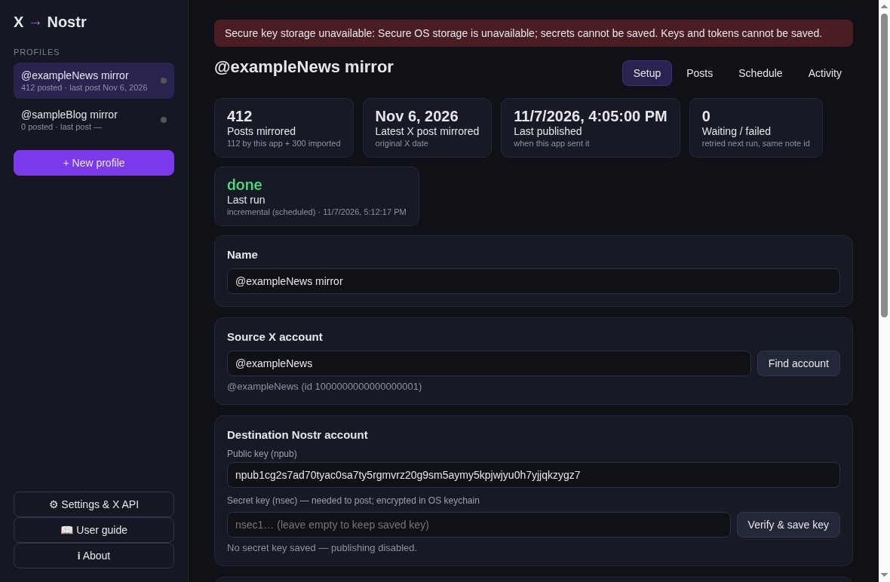

# X to Nostr Mirror

A local desktop app (macOS first, also runs on Linux) that copies posts from X (Twitter) accounts to Nostr
accounts. Supports many independent **profiles** (one X source → one Nostr destination each), previews before
publishing, history backfill, backdated timestamps, and a scheduler. No AI, no cloud service, no telemetry.



User guide: [docs/USER_GUIDE.md](docs/USER_GUIDE.md) (also published at https://github.com/sumeet2025/x-to-nostr-mirror-guide/blob/main/docs/USER_GUIDE.md and built into the app).

## What you need
1. **An X API Bearer token** from your own developer app at https://developer.x.com.
   Your X username/password does **not** work, and nothing from Grok Bot or other assistants carries over.
   Reading a user's posts (`GET /2/users/:id/tweets`) requires an access level/credits that X sets;
   check current pricing and limits in the developer portal (not verified here).
   The X API only returns roughly the most recent ~3,200 posts of an account.
2. **A Nostr key pair**: the `npub` (public) and the `nsec` (secret, needed to sign posts).

## Install / build on a Mac
Full instructions: [../docs/BUILD_MAC.md](../docs/BUILD_MAC.md) (in the GitHub repository). Short version, needs Node.js 22.12+ (22 LTS or 24 LTS):
```bash
git clone https://github.com/sumeet2025/x-to-nostr-mirror-guide.git
cd x-to-nostr-mirror-guide/app
bash scripts/build-mac.sh     # npm ci, tests, security checks, builds dist/*.zip for this Mac's CPU
```
Then unzip `dist/X to Nostr Mirror-<version>-arm64-mac.zip` (Apple Silicon) or `dist/X to Nostr Mirror-<version>-mac.zip`
(Intel) and move the app to /Applications. The build is **unsigned and not notarized**: open it the first time with
right-click → Open → Open. Run from source instead: `npm ci && npm start`.

## Using it
1. **Settings & X API** → paste the Bearer token → *Verify & save* (it calls X once to check it).
2. **+ New profile** → enter the X handle → *Find account*.
3. Enter the destination `npub`, then the `nsec` → *Verify & save key*. The app checks the nsec derives that npub.
   Keys are encrypted with the macOS Keychain (Electron `safeStorage`) and never shown again.
   If secure storage is unavailable (e.g. Linux without a keyring), the app refuses to save secrets.
4. Pick relays, the minimum number that must accept each note (default 2), what to mirror, and timestamps:
   *original X time* (backdated `created_at`) or *time of publishing*.
5. **Posts tab** → *Fetch new posts*, *Fetch history (backfill)* or *Load saved X JSON…* → review the previews
   → tick posts → *Publish selected* (a confirmation dialog is shown first).
6. **Schedule tab** → start date/time, interval (min 15 min), optional active hours + time zone. Scheduled runs
   only publish when you also tick *Allow scheduled runs to publish without preview*. Nothing runs on install.

### When does the scheduler run?
- **While the app is open**: it checks every minute and runs due profiles.
- **When the app is closed (macOS)**: Settings → *Install background agent* writes
  `~/Library/LaunchAgents/org.example.xnostrmirror.scheduler.plist`, which starts the app headless
  (`--run-due`) every 15 minutes; it runs due profiles then exits. Remove it from the same screen.
- **Asleep/off/offline Macs run nothing.** On the next run, missed slots collapse into one catch-up run and
  the checkpoint ensures nothing is skipped (it just publishes later). Notes keep original timestamps if chosen.

## How it avoids duplicates
Per profile, `state.json` maps each X post id → Nostr event id, plus skipped/failed lists and a checkpoint
(`newest_seen_id`). The checkpoint only advances past posts that were fully handled; a failed post (fewer
relays accepted than your minimum) and later replies in its thread are retried on the next run. Each profile
has a lock file so two runs never overlap. X API errors back off (rate limits wait for X's reset time;
repeated failures back off 15 min → 12 h).

What is mirrored by default: original posts, quote posts, the account's own threads (NIP-10 reply tags),
and threads whose first post was deleted. Reposts and replies to other accounts are off by default
(can be turned on). Notes end with `Originally on X: <link>`, media URLs are included with `imeta` tags.

## Data locations (macOS)
`~/Library/Application Support/X to Nostr Mirror/`: `jobs.json` (settings), `jobs/<id>/state.json`,
`events.jsonl` (signed public events), `raw/` (fetched X JSON), `log.txt`, `secrets.enc.json`
(Keychain-encrypted). Export/Import in Settings moves profile settings only (no keys, tokens or history).

## Moving from the earlier script-based mirror
See [docs/MIGRATION.md](docs/MIGRATION.md).

## Development
```bash
npm ci
npm test                 # unit + end-to-end tests with fake X data and local test relays
npm run security-check   # static Electron hardening checks
npm start
```
Layout: `src/core` (pure Node: X client, mirroring rules, relays, store, scheduler, launchd, secrets),
`src/main` (Electron main + preload with an IPC allowlist), `src/renderer` (UI, no Node access).

## Limitations
- Needs a working X API Bearer token with read access to user timelines; cost/limits are X's.
- t.co links missing from the API's `entities` are left as t.co links (no extra network lookups).
- Media is linked (pbs.twimg.com/video.twimg.com), not re-uploaded; links may stop working if X removes them.
- Builds are unsigned; macOS Gatekeeper will warn. Not notarized.
- Nostr notes cannot be reliably deleted once published.
